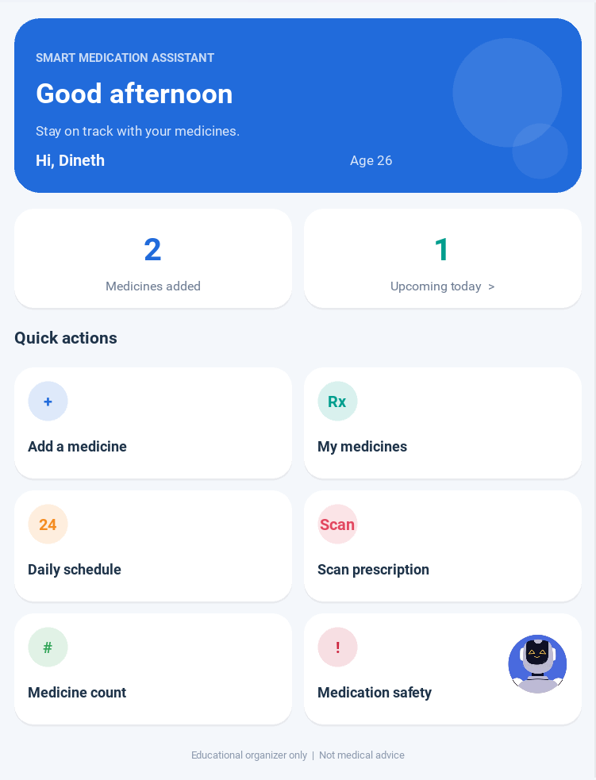
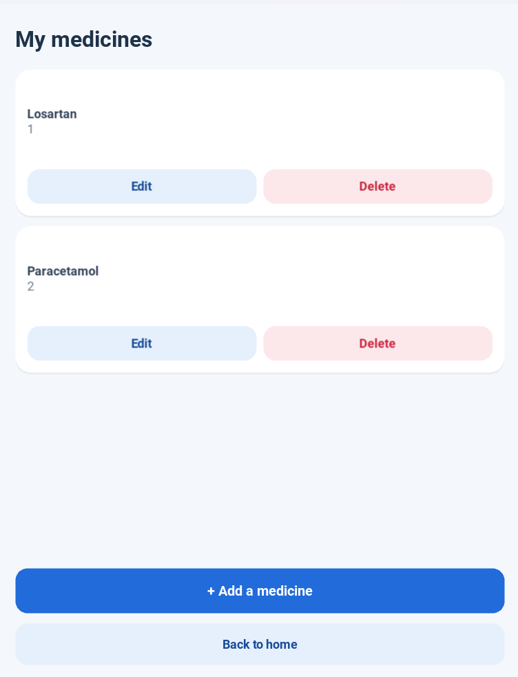
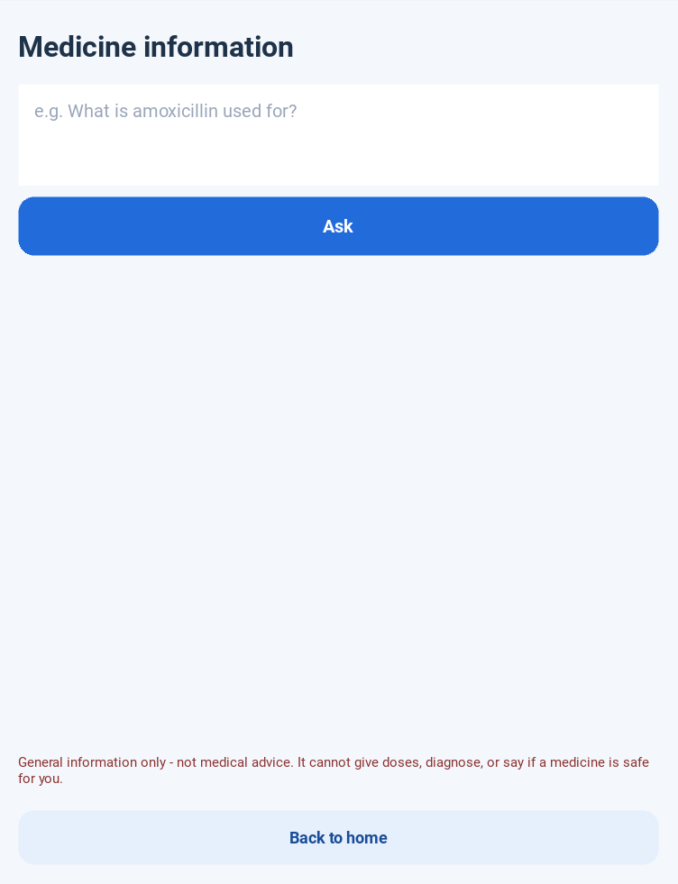

[README.md](https://github.com/user-attachments/files/34441294/README.md)
# Smart Medication Assistant

> A friendly Android/desktop medicine organizer with exact-time reminders,
> pill-supply tracking, prescription scanning and a **safety-first AI helper**.


<!-- Add screenshots to docs/ and uncomment:
<p align="center">
  
  
  
  
</p>
-->

## Why this exists
Missed doses and running out of pills are everyday problems, especially for
older people and carers. This app keeps everything in one simple place and
works offline. AI is used only where it helps, and is fenced in so it can
never act as a doctor.

## Features
- **Dashboard** with today's overview and quick actions
- **Medicine list**: add, edit, delete
- **Daily schedule** with exact-time Android alarms that survive reboots
- **Supply tracking**: estimates when pills run out and sends a
  "time to buy" notification 3 days before
- **Prescription scan (OCR)**: photo to text, with a consent screen and a
  "I checked this" confirmation before the text can be copied
- **Medicine information assistant** powered by  Gemini
- **Safety screen** with storage and emergency guidance (Sri Lanka: 1990)

## Safety design of the AI helper
| Layer | What it does |
|-------|--------------|
| 1. Local screening | Regex filter blocks dosing, diagnosis and "is it safe" questions and flags emergencies **before** anything is sent to the API. Works offline. |
| 2. System prompt | Tells the model the same limits as a backstop and treats user text as data, not instructions. |
| 3. Fixed disclaimer | Always appended by the UI, never model-generated. |

The app never recommends doses or checks interactions. It is an organizer,
not a medical device.

## Project layout
```
SmartMedicationAssistant/
├── main.py                  app, popups, alarm + supply logic
├── kv/main.kv               schedule screen layout
├── core/
│   ├── database.py          SQLite layer
│   ├── medication_manager.py
│   ├── schedule_manager.py
│   ├── notifications.py     Python <-> Android bridge
│   └── ai_assistant.py      screening, prompts, API calls
├── screens/
│   ├── __init__.py          app-wide theme (colors, buttons, cards)
│   ├── home.py
|   ├── medicines.py  
|   ├── add_medicine.py
│   ├── medicine_count.py  
|   ├── safety.py  
|   ├── ai_screens.py
├── java_src/org/smartmed/ReminderReceiver.java
├── api_key.txt
├── buildozer.spec
├── requirements.txt
├── text_ai.py
└── manifest_extra.xml
```

## Run on Windows
```powershell
py -3.11 -m venv .venv
.venv\Scripts\Activate.ps1
python -m pip install -r requirements.txt
python main.py
```

## AI key (never commit it!)
Set an environment variable **or** create `api_key.txt` next to `medication.db`:
(1) Visit [here](https://aistudio.google.com/) and create an api key
(2) Add api key to `api_key.txt` file
(3) Run `text_ai.py` file to get supporting models for your key
(4) Add a working model to "MODEL = "gemma-4-26b-a4b-it"" line in `core/ai_assistant.py` file
For a public release, ignore `api_key.txt` and route calls through your own small backend so no key ships inside the APK.

## Build the Android APK
```bash
pip install buildozer
buildozer android debug
```
In `buildozer.spec` set `requirements = python3,kivy,pyjnius,plyer,certifi,pillow,android`,
add `java_src/` as `android.add_src`, and `manifest_extra.xml` via
`android.extra_manifest_application_arguments`.

## Hackathon pitch (DSH Hacks)
- **Problem:** Building meaningful technical products in AI and healthcare that solve real-world problems.
- **Solution:** Smart Medication Assistant is an offline-first medicine organizer and smart supply tracker featuring reliable native Android alarms, an offline prescription OCR scanner, and a multi-layer safety-fenced Gemini AI assistant.
- **Demo flow (60s):** add medicine -> set schedule -> alarm fires -> scan
  prescription -> ask the AI a question -> try a dosing question and watch it
  get blocked
- **Tech:** Kivy, SQLite, Android AlarmManager via pyjnius, Gemini API
- **Team / links:** SOLO

## License
MIT (see `LICENSE`).
